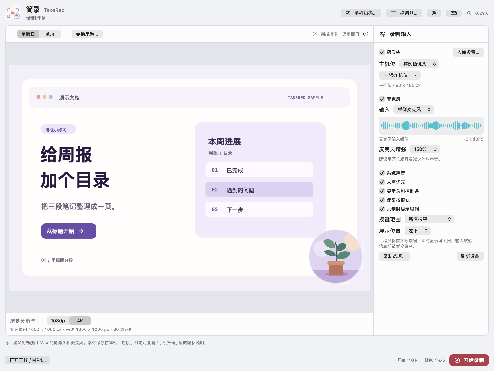
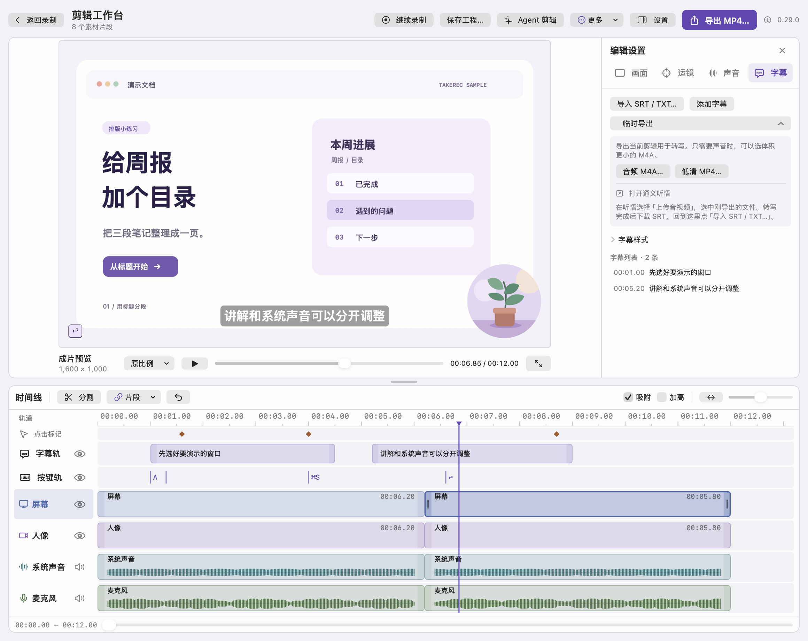

# 第一次录制 · Your first recording

[简体中文](#简体中文) · [English](#english) · [TakeRec](README.md)

## 简体中文

我们先录一个约 10 秒的小视频。在「文本编辑」里打一行字，最后把视频保存到桌面。每一步做完再往下走就好。

### 1. 打开简录

1. [下载简录 Mac 测试版](https://github.com/Raymond-Hear/TakeRec/releases/download/v0.29.0/TakeRec-0.29.0-macOS-universal.zip)。它支持 macOS 15 或更新版本，以及 Apple 芯片和 Intel Mac。
2. 在 Finder 的「下载」里双击 ZIP 解压，再双击解压出来的「简录.app」。

如果 macOS 拦截了首次打开，请先确认下载来自这个仓库，再到「系统设置 → 隐私与安全性」查看「仍要打开」。[Apple 打开 App 的说明](https://support.apple.com/zh-cn/102445)

### 2. 看一眼权限

看到「设置录制权限」时，**这次练习可以先点右下角的「完成」或「暂不设置」**。等到选窗口时，macOS 会请你确认共享哪个窗口。以后想加什么功能，就开对应的权限。

| 简录里的权限 | 什么时候需要 |
| --- | --- |
| 屏幕与系统音频录制 | 这次在 macOS 选择器里共享单个窗口即可。以后全屏录制时，想显示录制控制条和提词器并把它们排除在成片外，再给简录屏幕录制权限。 |
| 摄像头 | 想把人像一起录进去时开启。 |
| 麦克风 | 想把自己的解说录进去时开启。 |
| 输入监控 | 想在成片里展示按了哪些键，并开启「保留按键轨」时使用。 |

以后需要授权时，点简录右上角的盾牌图标「权限设置」，再点对应权限旁的设置按钮。按 macOS 提示操作，回到简录点「重新检查」，等那一项显示「已就绪」。如果系统提示重开简录，重开后会回到权限引导。[Apple 屏幕录制权限说明](https://support.apple.com/zh-cn/guide/mac-help/mchld6aa7d23/mac)

### 3. 选中要录的窗口

1. 打开 Mac 自带的「文本编辑」，点「新建文稿」，或按 <kbd>⌘N</kbd> 新建一份空白文稿。先留着这个窗口。
2. 回到简录，在左上角选「单窗口」，点旁边的「选择录制内容…」。在 macOS 弹出的选择器里选中文本编辑的文稿，按提示确认共享。
3. 看到简录左侧出现空白文稿的预览，就选对了。右侧把「摄像头」「麦克风」「系统声音」「保留按键轨」保持关闭，把「显示录制控制条」保持勾选。

   
  录制准备页的演示图。你的预览会显示空白文稿，右下角就是「开始录制」。

如果「开始录制」是灰色的，先确认左侧已经出现文稿预览，再看看右侧的摄像头和麦克风是否都已关闭。

### 4. 录十秒，再结束

1. 点简录右下角的「开始录制」。看到录制控制条开始计时，再点一下文本编辑的文稿。
2. 慢慢打下「这是我的第一个简录视频」，停两秒。
3. 点录制控制条上的「结束」。如果找不到控制条，按住 <kbd>Control</kbd> 和 <kbd>Shift</kbd>，再按 <kbd>S</kbd>。简录会打开「剪辑工作台」。

### 5. 回看刚录的画面

点「成片预览」下方的 ▶ 播放。看到那行字出现在画面里，就可以导出了。

   
  剪辑工作台的演示图。先点播放，再点右上角的「导出 MP4…」。

### 6. 把第一个视频存到桌面

1. 点右上角的「导出 MP4…」。在弹出的窗口里给文件取名「第一次简录」，把位置选为「桌面」。
2. 「成片分辨率」选 1080p 上限，点「导出 MP4」。
3. 等底部出现「MP4 已导出」，点顶部的「播放成片」。桌面上的「第一次简录.mp4」就是可以发给别人的视频。

下次想把自己的声音也录进去，可以在开录前开启「麦克风」、按提示允许，然后说一句话。看到右侧电平跟着动了，再点「开始录制」。

## English

Let’s make a short video, about ten seconds long. You’ll type a line in TextEdit, then save the video to your desktop. The app is in Simplified Chinese, so the steps include the button labels you’ll see.

### 1. Open TakeRec

1. [Download the Mac preview](https://github.com/Raymond-Hear/TakeRec/releases/download/v0.29.0/TakeRec-0.29.0-macOS-universal.zip). It runs on Apple silicon and Intel Macs with macOS 15 or later.
2. In Finder, open Downloads and double-click the ZIP to unpack it. Then double-click `简录.app`.

If macOS blocks the first launch, confirm that you downloaded the app from this repository, then look for **Open Anyway** in System Settings → Privacy & Security. [Apple’s guide to opening apps](https://support.apple.com/en-us/102445)

### 2. Check the permissions

On the permissions screen 「设置录制权限」, **click 「完成」 (Done) or 「暂不设置」 (Skip for now)** for this exercise. macOS will ask you which window to share in the next step. You can grant the other permissions when you want to use those features.

| Permission in TakeRec | When you need it |
| --- | --- |
| 屏幕与系统音频录制 · Screen & System Audio Recording | For this exercise, share one window in the macOS picker. Grant screen recording permission later if you want to use the controls and teleprompter during a full-screen recording and keep them out of the video. |
| 摄像头 · Camera | When you want to record yourself on camera. |
| 麦克风 · Microphone | When you want to record your narration. |
| 输入监控 · Input Monitoring | When you want to enable 「保留按键轨」 and show the keys you press. |

When you need a permission later, click the shield icon 「权限设置」 in the upper right of TakeRec and click the settings button next to that permission. Follow the macOS prompts, then click 「重新检查」 (Check again) and look for 「已就绪」 (Ready). If macOS asks you to reopen TakeRec, the permission guide will reopen too. [Apple’s screen recording permission guide](https://support.apple.com/guide/mac-help/mchld6aa7d23/mac)

### 3. Choose the window to record

1. Open TextEdit and click New Document, or press <kbd>⌘N</kbd> to create a blank document. Leave that window open.
2. In TakeRec, choose 「单窗口」 (Single window) in the upper left. Click 「选择录制内容…」 next to it, choose your TextEdit document in the macOS picker, and confirm the share.
3. Check that the blank document appears in the preview on the left. On the right, leave 「摄像头」 (Camera), 「麦克风」 (Microphone), 「系统声音」 (System audio), and 「保留按键轨」 (Keep keystroke track) off. Keep 「显示录制控制条」 (Show recording controls) on.

   
  Recording setup with sample footage. You’ll see your blank document in the preview on the left and Start Recording in the lower right.

If the start button is gray, check that your document is visible in the preview and that the camera and microphone are both off.

### 4. Record ten seconds, then stop

1. Click 「开始录制」 (Start Recording) in the lower right. When the timer on the recording controls starts counting, click in the TextEdit document.
2. Slowly type “This is my first TakeRec video.” Wait two seconds.
3. Click 「结束」 (Stop) on the recording controls. If you can’t see the controls, hold <kbd>Control</kbd> and <kbd>Shift</kbd>, then press <kbd>S</kbd>. TakeRec opens 「剪辑工作台」 (the editor).

### 5. Play back your recording

Click ▶ below 「成片预览」 (Video preview). Once you see the line you typed, you’re ready to export.

   
  The editor with sample footage. Play your take, then click Export MP4 in the upper right.

### 6. Save your first video to the desktop

1. Click 「导出 MP4…」 (Export MP4) in the upper right. In the save dialog, name the file “My first TakeRec video” and choose Desktop.
2. Under 「成片分辨率」 (Video resolution), choose the 1080p option and click 「导出 MP4」 (Export MP4).
3. When you see 「MP4 已导出」 (MP4 exported), click 「播放成片」 (Play video) at the top. You can share the MP4 file on your desktop.

To record your voice next time, turn on 「麦克风」 before starting, grant microphone access, and say a few words. Once the level meter on the right moves as you speak, click Start Recording.
