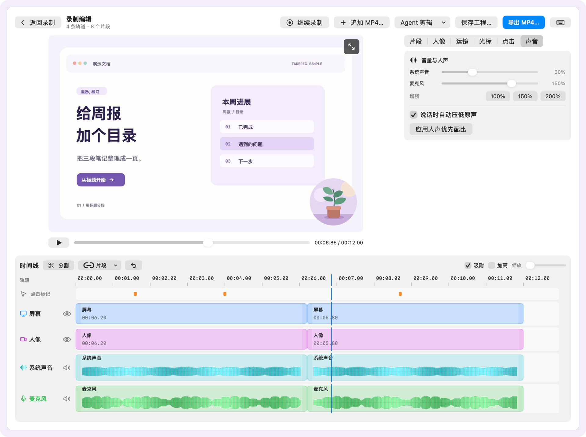
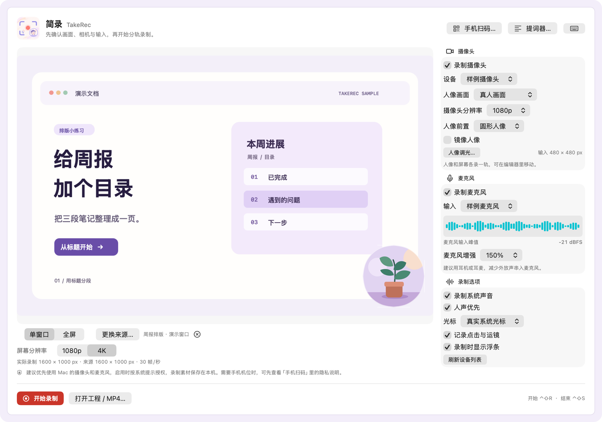

<div align="center">
  <p><a href="README.md">简体中文</a> · <strong>English</strong></p>
  
  <h1>TakeRec 简录</h1>
  <p><strong>An open-source Mac screen recorder for showing someone how it’s done.</strong></p>
  <p>
    <a href="https://github.com/Raymond-Hear/TakeRec/releases/tag/v0.15.0"></a>
    
    <a href="LICENSE"></a>
  </p>
  <p><a href="https://github.com/Raymond-Hear/TakeRec/releases/download/v0.15.0/TakeRec-0.15.0-macOS-universal.zip"><strong>Download the Mac preview</strong></a> · <a href="#why-i-built-it">Why I built it</a> · <a href="https://github.com/Raymond-Hear/TakeRec/issues">Share feedback</a></p>
</div>

<p align="center">
  <a href="docs/images/timeline-editor.png"></a><br>
  <sub>After recording, you can still bring a sentence forward or zoom in on the click that matters. Shown with sample footage.</sub>
</p>

## Why I built it

There are plenty of screen recorders. What I wanted was simple. Open a window, talk someone through a few clicks, and send them a recording they only have to watch once.

When I played a recording back, sometimes the text was fuzzy. Sometimes the sound from the webpage covered the part where I explained why I clicked that button. Usually I just wanted to bring those few words up or record the step I’d left out.

So I started building my own. I got recording and exporting working first. After a few more takes, I began keeping the screen, camera, microphone, and system audio on separate tracks. Now I can finish explaining what I’m doing, then adjust the sound or zoom in on a click when I play it back. If I leave a step out, I can record it and add it to the same project.

I’ve put TakeRec’s source here so you can try it on something of your own. It might be a tutorial, a demo of something you just built, or a ten-second clip showing a friend where that button is.

## Try a short take

<p align="center">
  <a href="docs/images/recording-preview.png"></a><br>
  <sub>Check the window, camera frame, and microphone level before you start. Shown with sample footage.</sub>
</p>

1. **Choose what to record.** Unzip the download and open `简录.app`. The preview runs on Apple silicon and Intel Macs. The app is currently in Simplified Chinese. Choose 「单窗口」 for a single window or 「全屏」 for the whole screen, then click 「选择录制内容…」 to choose the source.
2. **Record a few words.** Press <kbd>⌃⇧R</kbd> to start and <kbd>⌃⇧S</kbd> to stop. Turn on both the microphone and system audio before recording if you want to try mixing them separately.
3. **Play it back and make any adjustments.** Open 「声音」 (Audio) and try turning down the system track. Export an MP4 or save a `.desktake` project to edit later.

> The preview is ad hoc signed and has yet to be notarized by Apple. If macOS blocks the first launch, confirm you downloaded it from this repository, then look for “Open Anyway” in System Settings → Privacy & Security. [Apple’s guide to opening apps](https://support.apple.com/en-us/102445)

## Let me know how it went

If TakeRec saved you a retake, a **Star** is welcome. After trying it, feel free to open an **Issue** about what worked or where you got stuck. For a bug, include your TakeRec and macOS versions and a few steps to reproduce it in a blank window. [Open an issue](https://github.com/Raymond-Hear/TakeRec/issues)

<details>
<summary><strong>Build from source and debug</strong></summary>

Install the full Xcode app. This build was verified with Xcode 26.6. Open Xcode once to finish setting it up. If `xcode-select -p` points to the standalone command-line tools, select Xcode under Xcode → Settings → Locations → Command Line Tools.

```bash
git clone https://github.com/Raymond-Hear/TakeRec.git
cd TakeRec
./build.sh 'build/简录.app'
open 'build/简录.app'
```

The script uses a local ad hoc signature by default. Set `DESKTAKE_SIGN_IDENTITY` to use your own signing identity. To debug with breakpoints, build for your Mac’s architecture.

```bash
TAKEREC_BUILD_CONFIGURATION=debug ./build.sh 'build/简录-调试.app'
xcrun lldb 'build/简录-调试.app/Contents/MacOS/TakeRec'
```

Load the debug symbols in LLDB and break when the main window opens.

```text
target symbols add "build/简录-调试.app/Contents/Resources/TakeRec.dSYM"
breakpoint set --file DeskTakeApp.swift --line 44
run
```

To troubleshoot capture, record a blank window and enable the camera, microphone, and system audio one at a time. If an input is missing, check the selected device and its macOS privacy permission. Keeping TakeRec’s floating controls out of a full-screen recording requires macOS 15.2 or later. In Console, filter by the `TakeRec` process to find logs and crash reports.

</details>

<details>
<summary><strong>Privacy and third-party licenses</strong></summary>

When recording with local Mac inputs, TakeRec processes and saves footage on the Mac. Optional phone pairing uses VDO.Ninja for signaling and encrypted WebRTC for phone video and audio. If a direct connection fails, the media may travel via a TURN relay. The service may also handle IP addresses and connection diagnostics. [VDO.Ninja privacy policy](https://docs.vdo.ninja/help/privacy-and-security-details/vdo.ninja-privacy-policy)

Agent editing saves a media bundle to a local folder you choose and copies a prompt to the clipboard. You decide whether to share the bundle with another tool.

TakeRec’s code is MIT licensed. Lucide icons use the included ISC and MIT terms. The bundled VDO.Ninja SDK 1.6.2 uses MPL-2.0. [TakeRec license](LICENSE) · [Lucide licenses](App/Lucide-LICENSE.txt) · [VDO.Ninja SDK license](App/PhoneReceiver/VDO-Ninja-MPL-2.0.txt) · [SDK source](https://github.com/steveseguin/ninjasdk/tree/328965a06fa19cf47c3f01182e9cb1d91f39214e)

</details>
