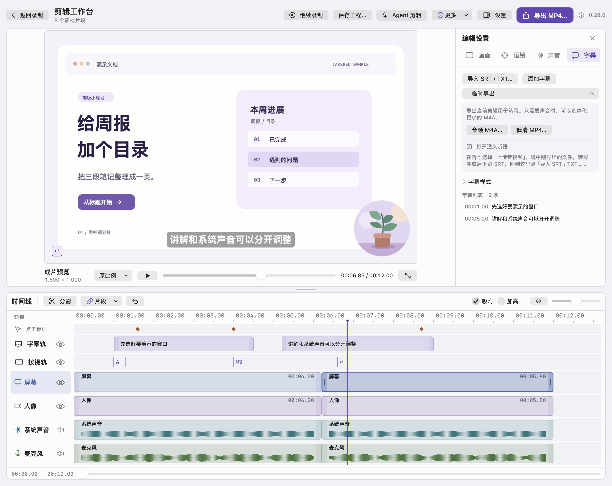

<div align="center">
  <p><a href="README.md">简体中文</a> · <strong>English</strong></p>
  
  <h1>TakeRec 简录</h1>
  <p><strong>An open-source Mac screen recorder for showing someone how it’s done.</strong></p>
  <p>
    <a href="https://github.com/Raymond-Hear/TakeRec/releases/tag/v0.36.1"></a>
    
    <a href="LICENSE"></a>
  </p>
  <p><a href="https://github.com/Raymond-Hear/TakeRec/releases/download/v0.36.1/TakeRec-0.36.1-macOS-universal.zip"><strong>Download the Mac preview</strong></a> · <a href="FIRST-RECORDING.md#english"><strong>Beginner tutorial</strong></a> · <a href="docs/使用说明.md"><strong>Full manual (Chinese)</strong></a> · <a href="#whats-new">What’s new</a> · <a href="https://github.com/Raymond-Hear/TakeRec/issues">Share feedback</a></p>
  <p><sub>The release is a basic build without the offline proofreading model. Build the full version from source below.</sub></p>
</div>

TakeRec records screen, camera, microphone, and system audio on separate tracks, then edits them on one timeline. You can also hand a media bundle to a local agent for a first rough cut.

## What’s new

- **Redo.** A redo button now sits in the toolbar and `⇧⌘Z` redoes the last edit. Undo and redo each keep the last 40 steps, so you can move back and forth while comparing cuts.
- **Agent bundles update in place.** Generating a bundle for the same project again updates the project manifest and only adds new media. It no longer copies the whole recording for every round. Imported plans can still be undone, previewed, and exported.
- **Easier gap closing.** Clips on all tracks shift together when you delete or trim. Right-click a gap to remove it and close picture, sound, and captions together.
- **B-roll, titles, and full-frame camera.** Add cutaway footage at the playhead, place emphasis titles, and fill a 16:9 or 9:16 canvas with a camera clip.
- **On-device caption proofreading.** With captions in the project, proofread them locally, keep the timecodes, and undo a whole batch at once.
- **One build output.** `./build.sh` now overwrites `build.noindex/简录.app` in place instead of creating a new versioned folder.

<p align="center">
  <a href="docs/images/timeline-editor.png"></a><br>
  <sub>Editing workspace · sample footage</sub>
</p>

If you found TakeRec useful, a **Star** is welcome. Tell me what worked for you and where it could improve. [Open an issue](https://github.com/Raymond-Hear/TakeRec/issues)

<details>
<summary><strong>Build from source</strong></summary>

Install and open the full Xcode app once, then run these commands.

```bash
git clone https://github.com/Raymond-Hear/TakeRec.git
cd TakeRec
./build.sh
open 'build.noindex/简录.app'
```

`./build.sh` overwrites `build.noindex/简录.app` in place. The release is a basic build without the offline proofreading model; to build the full version, prepare the model first.

```bash
bash prepare-proofreader.sh
./build.sh
```

The build uses an ad-hoc local signature by default. If macOS still reports a permission prompt after a rebuild, remove the old entry under Privacy & Security and add the current `简录.app` again.

</details>

<details>
<summary><strong>Privacy and third-party licenses</strong></summary>

TakeRec processes and saves footage from local inputs on your Mac. Keystroke capture is optional and runs during recording. Phone pairing uses VDO.Ninja for signaling and encrypted WebRTC for media. If a direct connection fails, the media may travel through a TURN relay. [VDO.Ninja privacy policy](https://docs.vdo.ninja/help/privacy-and-security-details/vdo.ninja-privacy-policy)

Agent bundles and transcription files are saved to a folder you choose. When using Tingwu, you select the file to upload on its website. Offline caption proofreading runs on your Mac; without the bundled model, TakeRec uses the Apple Intelligence model available on the system.

TakeRec’s code is MIT licensed. Lucide icons use the included ISC and MIT terms. The bundled VDO.Ninja SDK 1.6.2 uses MPL-2.0. [TakeRec license](LICENSE) · [Lucide licenses](App/Lucide-LICENSE.txt) · [VDO.Ninja SDK license](App/PhoneReceiver/VDO-Ninja-MPL-2.0.txt) · [SDK source](https://github.com/steveseguin/ninjasdk/tree/328965a06fa19cf47c3f01182e9cb1d91f39214e)

</details>

## About the author

I’m **聆风Raymond**, the creator of TakeRec.

- **WeChat Official Account**　聆风Raymond
- **Email**　[heylingfeng@111.com](mailto:heylingfeng@111.com)
- **GitHub**　[@Raymond-Hear](https://github.com/Raymond-Hear)

<p>
  <br>
  <sub>Scan with WeChat to follow</sub>
</p>
