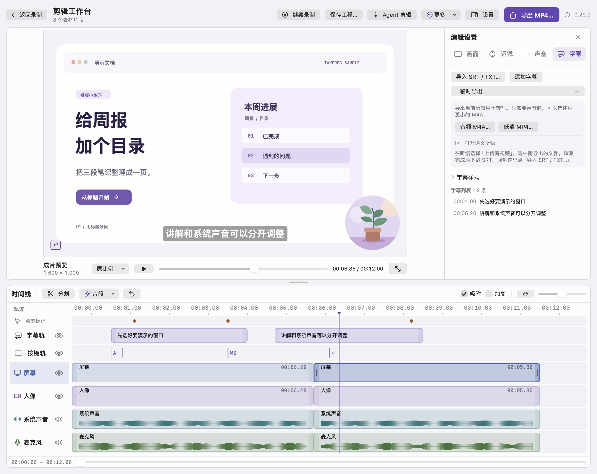

<div align="center">
  <p><strong>简体中文</strong> · <a href="README.en.md">English</a></p>
  
  <h1>简录 TakeRec</h1>
  <p><strong>给想把一个操作讲清楚的人做的开源 Mac 录屏工具。</strong></p>
  <p>
    <a href="https://github.com/Raymond-Hear/TakeRec/releases/tag/v0.36.1"></a>
    
    <a href="LICENSE"></a>
  </p>
  <p><a href="https://github.com/Raymond-Hear/TakeRec/releases/download/v0.36.1/TakeRec-0.36.1-macOS-universal.zip"><strong>下载 Mac 测试版</strong></a> · <a href="FIRST-RECORDING.md#简体中文"><strong>新手教程</strong></a> · <a href="docs/使用说明.md"><strong>完整使用说明</strong></a> · <a href="#本次更新">本次更新</a> · <a href="https://github.com/Raymond-Hear/TakeRec/issues">提交反馈</a></p>
  <p><sub>Release 提供不含离线校对模型的基础版；需要完整版可按下方说明从源码构建。</sub></p>
</div>

简录把屏幕、人像、麦克风和系统声音分轨录下，在一条时间线上完成剪辑、字幕、运镜和导出；也可以把素材包交给本地 Agent，先做一轮粗剪。

## 本次更新

- **重做**。工具栏新增重做按钮，快捷键 `⇧⌘Z`；撤销和重做各保留最近 40 步，剪辑时可以直接来回比较。
- **Agent 素材包原地更新**。同一工程再次生成素材包时只更新工程清单和新增素材，不再为每一轮复制整段录像；导入新方案后仍可撤销、预览和导出。
- **更顺手的合拢**。删除或缩短片段时各轨自动前移；空隙可以右键删除，画面、声音和字幕一起合拢。
- **B-roll、花字和人像全屏**。在播放头补画面、加重点花字；人像片段可一键铺满 16:9 或 9:16 画布。
- **AI 校对字幕**。工程中有字幕后可以在本机校对，字幕时间码保留，整批修改一次撤销。
- **构建只留一个 App**。`./build.sh` 固定原位覆盖 `build.noindex/简录.app`，不再生成版本目录。

<p align="center">
  <a href="docs/images/timeline-editor.png"></a><br>
  <sub>剪辑工作台 · 演示素材</sub>
</p>

用过之后欢迎点个 **Star**，也欢迎告诉我哪里顺手、哪里还可以改。[提交 Issue](https://github.com/Raymond-Hear/TakeRec/issues)

<details>
<summary><strong>从源码构建</strong></summary>

安装并打开一次完整的 Xcode 后，在终端运行。

```bash
git clone https://github.com/Raymond-Hear/TakeRec.git
cd TakeRec
./build.sh
open 'build.noindex/简录.app'
```

`./build.sh` 会原位覆盖 `build.noindex/简录.app`。Release 里的基础版不含离线校对模型；需要完整版时，先准备模型再构建。

```bash
bash prepare-proofreader.sh
./build.sh
```

构建脚本默认使用本机临时签名。重新构建后如果系统设置显示已授权、应用仍提示需要权限，请在「隐私与安全性」里移除旧条目，再重新添加当前的「简录.app」。

</details>

<details>
<summary><strong>素材隐私与第三方许可</strong></summary>

使用本机输入录制时，素材在 Mac 上处理和保存。按键轨由你开启，只在录制期间采集。手机扫码通过 VDO.Ninja 配对，并通过加密 WebRTC 传输。无法直连时可能经 TURN 中继。[VDO.Ninja 隐私说明](https://docs.vdo.ninja/help/privacy-and-security-details/vdo.ninja-privacy-policy)

Agent 素材包和临时转写文件导出到你选择的本机位置。使用通义听悟时，由你在网页上选择要上传的文件。离线字幕校对在 Mac 本机完成；没有随包模型时会改用系统可用的 Apple Intelligence 端侧模型。

简录代码采用 MIT。Lucide 图标按随附的 ISC 与 MIT 许可分发，VDO.Ninja SDK 1.6.2 按 MPL-2.0 分发。[简录许可](LICENSE) · [Lucide 许可](App/Lucide-LICENSE.txt) · [VDO.Ninja SDK 许可](App/PhoneReceiver/VDO-Ninja-MPL-2.0.txt) · [SDK 对应源码](https://github.com/steveseguin/ninjasdk/tree/328965a06fa19cf47c3f01182e9cb1d91f39214e)

</details>

## 关于作者

我是 **聆风Raymond**，简录的作者。

- **公众号**　聆风Raymond
- **邮箱**　[heylingfeng@111.com](mailto:heylingfeng@111.com)
- **GitHub**　[@Raymond-Hear](https://github.com/Raymond-Hear)

<p>
  <br>
  <sub>微信扫码关注</sub>
</p>
