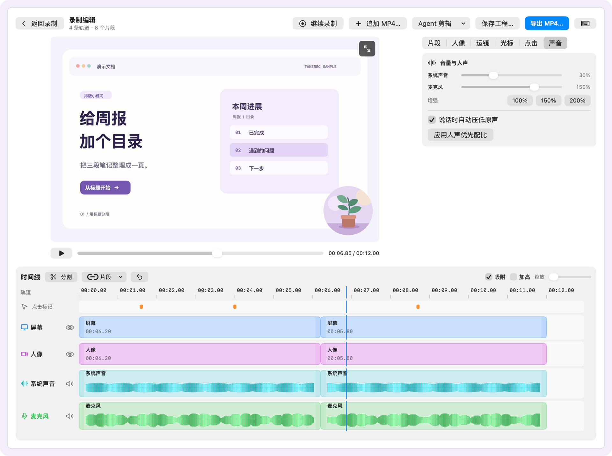
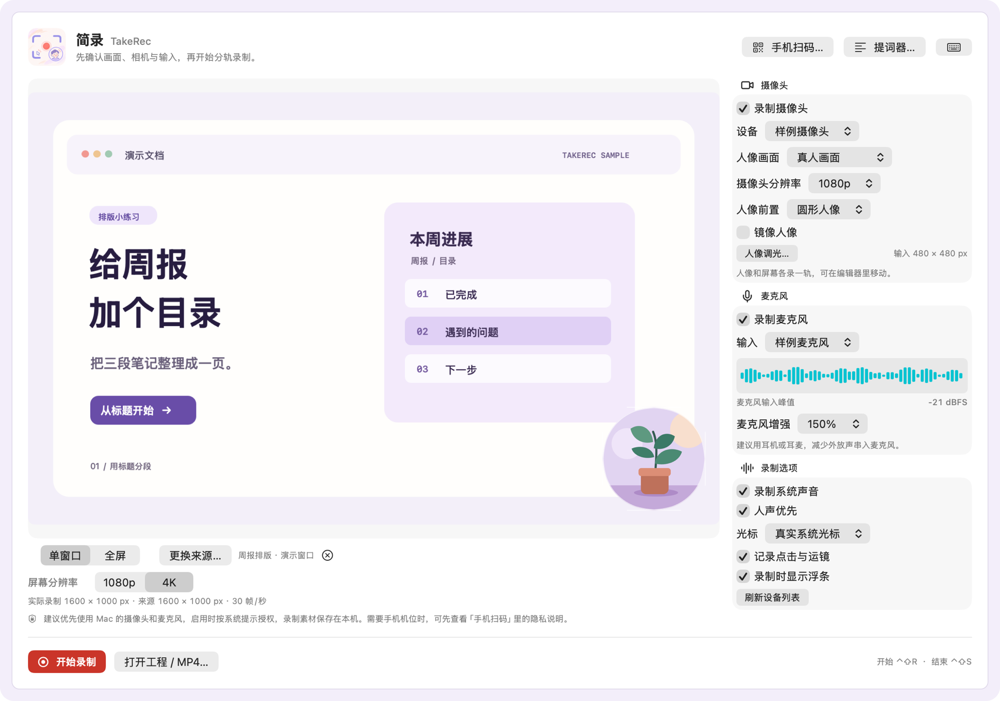

<div align="center">
  <p><strong>简体中文</strong> · <a href="README.en.md">English</a></p>
  
  <h1>简录 TakeRec</h1>
  <p><strong>给想把一个操作讲清楚的人做的 Mac 录屏工具。</strong></p>
  <p>
    <a href="https://github.com/Raymond-Hear/TakeRec/releases/tag/v0.15.0"></a>
    
    <a href="LICENSE"></a>
  </p>
  <p><a href="https://github.com/Raymond-Hear/TakeRec/releases/download/v0.15.0/TakeRec-0.15.0-macOS-universal.zip"><strong>下载 Mac 测试版</strong></a> · <a href="#为什么做简录">为什么做简录</a> · <a href="https://github.com/Raymond-Hear/TakeRec/issues">提交反馈</a></p>
</div>

<p align="center">
  <a href="docs/images/timeline-editor.png"></a><br>
  <sub>录完回看时，哪一句需要听清，哪一处点击值得放大，都还来得及调。图中为演示素材。</sub>
</p>

## 为什么做简录

录屏软件已经很多了。我想录的也很简单，打开一个窗口，边点边讲，让对方看一遍就知道该怎么做。

可录完回看，有时窗口里的字变糊了，有时网页声音一响，我解释为什么点那个按钮的几句就听不清了。碰到这种情况，我想做的往往只是把那几句拉响，或者补录漏掉的一步。

后来我干脆自己做了一个。第一版先把录制和导出做通。再一段段试，才慢慢把屏幕、摄像头、麦克风和系统声音分开存。这样录的时候可以先把话说完，回看时再调声音、放大一次点击。少讲了一步，也可以接着录。

现在我把简录开源了。你可以拿它录一段教程、演示一个刚做好的功能，也可以只录十几秒，给朋友看看那个按钮到底在哪儿。

## 先录一小段

<p align="center">
  <a href="docs/images/recording-preview.png"></a><br>
  <sub>开录前，先确认要录的窗口、相机画面和麦克风电平。图中为演示素材。</sub>
</p>

1. **选好要录的画面。** 解压后打开「简录.app」，选单窗口或全屏，再点「选择录制内容…」。测试包支持 Apple 芯片和 Intel Mac。
2. **讲两句试试。** 按 <kbd>⌃⇧R</kbd> 开始、<kbd>⌃⇧S</kbd> 结束。想试分轨调音，开录前同时打开麦克风和系统声音。
3. **回看，调到满意再导出。** 在「声音」里试着把原声调低一点。可以导出 MP4，也可以保存为 `.desktake` 工程，下次接着剪。

> 测试包使用临时签名，尚未经过 Apple 公证。首次打开若被拦截，请核对下载来源，再到「系统设置 → 隐私与安全性」查看「仍要打开」。[Apple 打开 App 的说明](https://support.apple.com/zh-cn/102445)

## 录完，欢迎回来聊两句

如果简录帮你省了一次重录，欢迎在仓库右上角点个 **Star**。用过之后，哪里顺手、哪里还让你绕了弯，都欢迎来提一条 **Issue**。遇到问题时，写下简录和 macOS 的版本，再用一个空白窗口说说怎么复现就好。[提交 Issues](https://github.com/Raymond-Hear/TakeRec/issues)

<details>
<summary><strong>从源码构建与调试</strong></summary>

需要安装完整的 Xcode。本版用 Xcode 26.6 验证过。首次使用 Xcode 时，先打开一次并完成组件安装。如果 `xcode-select -p` 指向单独的命令行工具目录，可在「Xcode → Settings → Locations → Command Line Tools」选择 Xcode。

```bash
git clone https://github.com/Raymond-Hear/TakeRec.git
cd TakeRec
./build.sh 'build/简录.app'
open 'build/简录.app'
```

脚本默认使用本地临时签名。也可通过 `DESKTAKE_SIGN_IDENTITY` 指定自己的签名身份。需要下断点时，构建当前 Mac 架构的调试版。

```bash
TAKEREC_BUILD_CONFIGURATION=debug ./build.sh 'build/简录-调试.app'
xcrun lldb 'build/简录-调试.app/Contents/MacOS/TakeRec'
```

在 LLDB 中载入符号，让程序在主窗口打开时停下来。

```text
target symbols add "build/简录-调试.app/Contents/Resources/TakeRec.dSYM"
breakpoint set --file DeskTakeApp.swift --line 44
run
```

排查采集时，可以用空白窗口短录，逐项开启相机、麦克风和系统声音。没有输入时，先检查所选设备和 macOS「隐私与安全性」里的授权。全屏录制时排除简录浮窗需要 macOS 15.2 或以上。在「控制台」里按进程名 `TakeRec` 可以查日志和崩溃报告。

</details>

<details>
<summary><strong>素材隐私与第三方许可</strong></summary>

用 Mac 本机输入录制时，素材在本机处理和保存。手机扫码是可选功能，通过 VDO.Ninja 配对，再通过加密 WebRTC 把手机画面和声音传给 Mac。无法直连时可能经过 TURN 中继，服务也可能处理 IP 与连接诊断。[VDO.Ninja 隐私说明](https://docs.vdo.ninja/help/privacy-and-security-details/vdo.ninja-privacy-policy)

「Agent 剪辑」会把素材包写到你选的本机文件夹，并把提示词复制到剪贴板。是否交给其他工具，由你决定。

简录代码采用 MIT。Lucide 图标按随附的 ISC 与 MIT 许可分发，VDO.Ninja SDK 1.6.2 按 MPL-2.0 分发。[简录许可](LICENSE) · [Lucide 许可](App/Lucide-LICENSE.txt) · [VDO.Ninja SDK 许可](App/PhoneReceiver/VDO-Ninja-MPL-2.0.txt) · [SDK 对应源码](https://github.com/steveseguin/ninjasdk/tree/328965a06fa19cf47c3f01182e9cb1d91f39214e)

</details>
